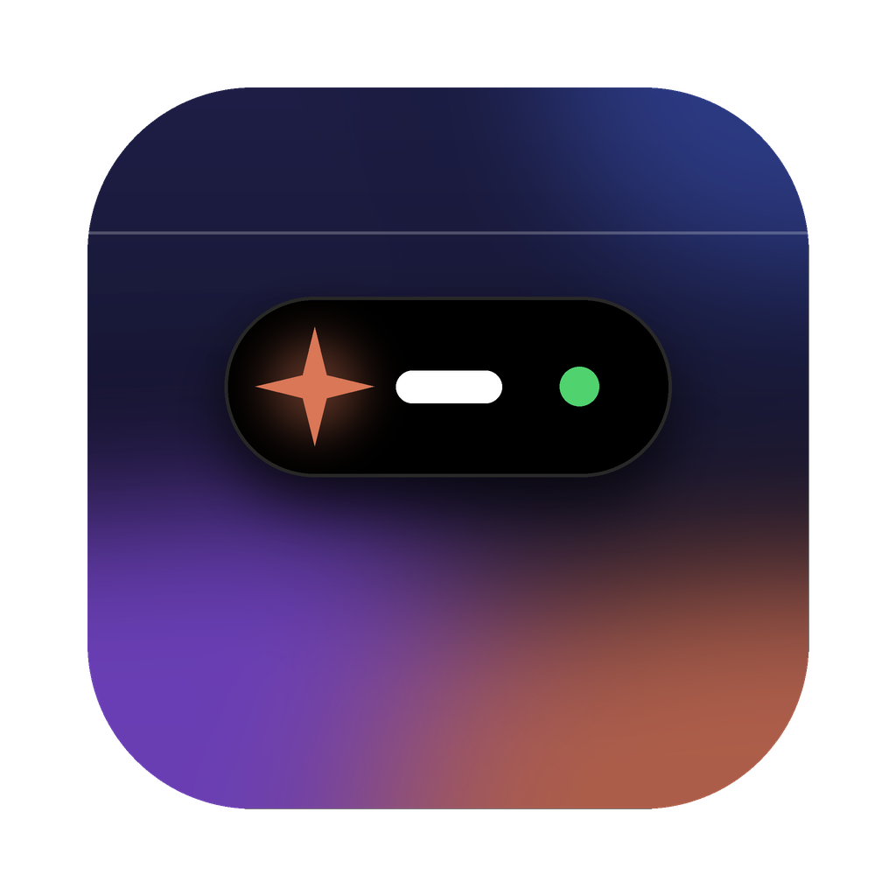
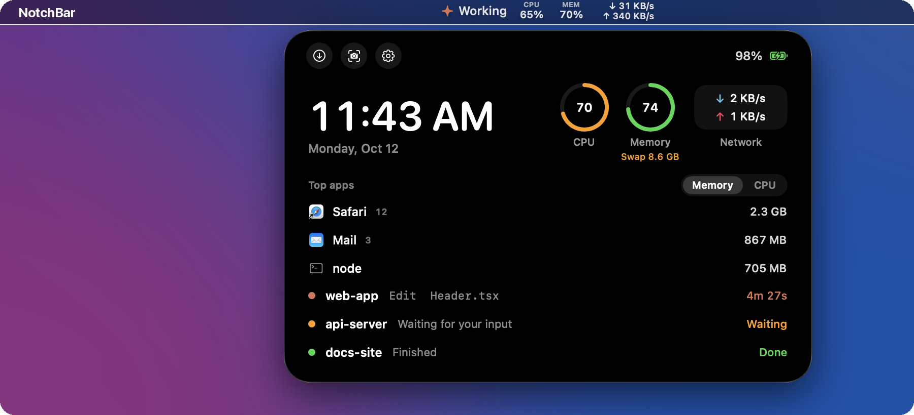
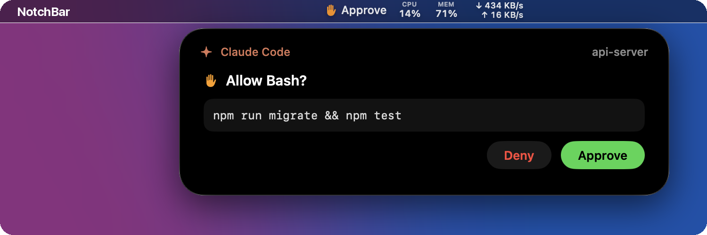
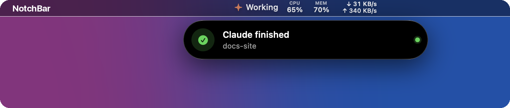

<p align="center"></p>

# NotchBar

A macOS menu bar app that shows a "Dynamic Island" for live activities, Claude Code and system stats.



- **Macs with a notch:** the island wraps around the hardware notch. That area is dead space, so it never covers menu bar icons.
- **Macs without a notch:** it works like Live Activities in macOS Tahoe. The compact view is a menu bar item, and clicking it drops the expanded view down *below* the menu bar. Right-click the item for settings.

## Install
1. Download the latest **NotchBar-x.y.z.dmg** from [Releases](https://github.com/rikenpatel02/notchbar/releases/latest).
2. Open it and drag **NotchBar** onto **Applications**.
3. Open NotchBar from Applications.

Requires macOS 13 or later, on Apple Silicon or Intel. If you open it straight from the disk image or Downloads, NotchBar offers to move itself to Applications. It needs a fixed location so Claude Code can find it and it can open at login.

**"Apple could not verify NotchBar"?** Builds that aren't notarized by Apple show this the first time. Open **System Settings > Privacy & Security**, scroll to Security, click **Open Anyway** next to NotchBar, and confirm with your password. You only do this once. The disk image includes **If NotchBar won't open**, a picture guide to these steps.

## First launch and permissions
NotchBar has no Dock icon; it lives in the menu bar. On first launch a setup window walks through three optional steps. Reopen it any time with **Setup...** in the menu bar item's right-click menu, or `NotchBar setup` from a terminal.

| Step | What it does | What macOS shows |
|---|---|---|
| **Connect Claude Code** | Adds NotchBar's hooks to `~/.claude/settings.json`, keeping your other settings and hooks, and saves `settings.json.notchbar-backup` first. **Disconnect** removes only NotchBar's hooks. | Nothing |
| **Open at login** | Registers NotchBar as a login item (on by default). | A "Background Items Added" notification; manage it in System Settings > General > Login Items |
| **Jump to terminal tabs** | Lets a click on a session bring its Terminal or iTerm2 tab to the front, and skips banners for the tab you're already looking at. | "NotchBar wants access to control Terminal." Change it later in Privacy & Security > Automation |

Other prompts you might see:
- **Downloads folder:** the first click on the Downloads shortcut in the panel. macOS asks before any app opens that folder.

NotchBar never asks for Accessibility, Screen Recording, Full Disk Access or network access. Every permission is optional; without them, the stats and island still work.

## Menu bar item
Always shows, left to right:
- **Claude:** "Working" / "N working", or "Approve" when a permission card is waiting
- **CPU:** share of all cores busy over the last second. Turns orange at 75% and red at 90%
- **MEM:** Activity Monitor's "Memory Used" as a share of RAM. Its color follows macOS **memory pressure**, not the percent (macOS keeps RAM full on purpose), so it only turns orange or red when memory is actually short
- **Network:** download and upload rates across Wi-Fi, Ethernet and cellular

Turn the stats off with **Show Stats in Menu Bar** in the right-click menu. Sampling then stops.

<table>
  <tr>
    <td width="50%"></td>
    <td width="50%"></td>
  </tr>
  <tr>
    <td align="center"><b>Approve or deny</b> Claude Code tool calls</td>
    <td align="center"><b>Live banners</b> when Claude finishes or needs you</td>
  </tr>
</table>

## Expanded panel
- Shortcuts (Downloads, Screenshot, System Settings), battery, clock
- **Live stats:** CPU and memory gauges, network rates, and swap in use (orange once swap passes a quarter of RAM)
- **Top apps:** the three biggest users by Memory or CPU. Helper processes are folded into their app (all of Chrome's renderers count as Chrome). Hover a row for **Quit**, then click **Quit?** to confirm
- **Claude sessions:** project, last tool, and a timer for how long it has been working. Click a row to bring that session's terminal tab to the front. A shield icon marks sessions running with `--dangerously-skip-permissions`

Hovering expands it and moving away collapses it. Opened with a click, the menu or the CLI, it stays open until you click outside it.

## Uninstall
1. Right-click the menu bar item, choose **Setup...**, click **Disconnect** next to Claude Code, and turn off **Open at login**.
2. Quit NotchBar from the same menu and drag it from Applications to the Trash.
3. Optionally, `defaults delete com.rikenpatel.notchbar` clears its preferences.

## Build & run
```bash
./build.sh --install    # build, copy to /Applications, launch (registers Launch at Login on first run)
./build.sh --run        # run the local build without installing
```
You need macOS 13 or later and a Swift toolchain (the Xcode Command Line Tools are enough). Turn Launch at Login on or off from the right-click menu.

## Claude Code
**Connect Claude Code** in the setup window does this for you. To do it by hand instead, add NotchBar as a command hook in `~/.claude/settings.json` (with the app in `/Applications`), merged into any `hooks` you already have:

```json
{
  "hooks": {
    "UserPromptSubmit": [{ "hooks": [{ "type": "command", "command": "/Applications/NotchBar.app/Contents/MacOS/NotchBar hook", "timeout": 5 }] }],
    "PreToolUse":       [{ "hooks": [{ "type": "command", "command": "/Applications/NotchBar.app/Contents/MacOS/NotchBar hook", "timeout": 5 }] }],
    "Notification":     [{ "hooks": [{ "type": "command", "command": "/Applications/NotchBar.app/Contents/MacOS/NotchBar hook", "timeout": 5 }] }],
    "Stop":             [{ "hooks": [{ "type": "command", "command": "/Applications/NotchBar.app/Contents/MacOS/NotchBar hook", "timeout": 5 }] }],
    "SessionEnd":       [{ "hooks": [{ "type": "command", "command": "/Applications/NotchBar.app/Contents/MacOS/NotchBar hook", "timeout": 5 }] }],
    "PermissionRequest":[{ "hooks": [{ "type": "command", "command": "/Applications/NotchBar.app/Contents/MacOS/NotchBar hook", "timeout": 130 }] }]
  }
}
```

The hook reports the session's tty, terminal app (`TERM_PROGRAM`) and permission mode along with each event.

- **Working / Done / Waiting:** live status in the menu bar item, the session list, and banners. Banners are skipped when that session's terminal tab is already the one in front (Terminal and iTerm2).
- **PermissionRequest:** the island opens with an Approve/Deny card and the hook waits for your choice. If you don't answer within 120s (override with `NOTCHBAR_PERMISSION_TIMEOUT`, and keep the hook `timeout` above it), the hook exits without a decision and Claude falls back to its normal terminal prompt. If NotchBar isn't running, the hook exits immediately.
- **Skip-permissions sessions:** sessions started with `--dangerously-skip-permissions` never ask, so no cards appear for them. Start Claude without that flag to approve from the island.
- **Sessions started before NotchBar (optional):** if you already have a hook that writes one JSON file per session to `~/.claude/status/` (fields `session_id`, `project`, `status`, `updated_at`, `tty`, `term`, `message`), NotchBar restores those sessions at launch and every 30s, keeping only terminals that still run `claude`. Without it, sessions appear from their next hook event.

Jumping to a terminal tab and checking which tab is in front use AppleScript, so macOS asks once for permission to control Terminal (System Settings > Privacy & Security > Automation). Because the app is ad-hoc signed, a rebuild may ask again.

## Drive it from scripts
```bash
B=build/NotchBar.app/Contents/MacOS/NotchBar
$B toast "Build passed" "notchbar - 12s" checkmark.circle.fill green
$B open | close | toggle | hide | show | setup
```
Commands are sent to the running app as a distributed notification, so scripts and hooks need no extra permissions.

## Demo mode
`NOTCHBAR_DEMO=1 build/NotchBar.app/Contents/MacOS/NotchBar` shows sample sessions and apps instead of your own, and ignores real Claude Code events. Use it for screenshots; Quit is disabled while it runs.

## Releasing
`scripts/release.sh 0.2.0` builds a universal app (Apple Silicon and Intel) and `build/NotchBar-0.2.0.dmg`, laid out as NotchBar beside an Applications shortcut (via `dmgbuild`, installed into `build/.venv` on first run). Pushing a tag such as `v0.2.0` runs the same script in GitHub Actions and publishes the DMG to a GitHub Release.

Without signing credentials the DMG is ad-hoc signed, so users approve it once in Privacy & Security. To sign and notarize, join the Apple Developer Program, create a **Developer ID Application** certificate, and add these repository secrets: `MACOS_CERTIFICATE` (base64 .p12), `MACOS_CERTIFICATE_PASSWORD`, `SIGN_IDENTITY`, `APPLE_ID`, `APPLE_TEAM_ID` and `APPLE_APP_PASSWORD` (an app-specific password). Locally, set `SIGN_IDENTITY` plus `NOTARY_PROFILE` (from `xcrun notarytool store-credentials`). The icon is drawn by `scripts/make-icon.py` and the in-DMG guide by `scripts/make-open-guide.py`.

## Privacy
Everything stays on your Mac. NotchBar makes no network requests and collects nothing; the network meter only reads interface byte counters. Claude Code events travel between the hook and the app as local distributed notifications.

## License
MIT. See [LICENSE](LICENSE).
